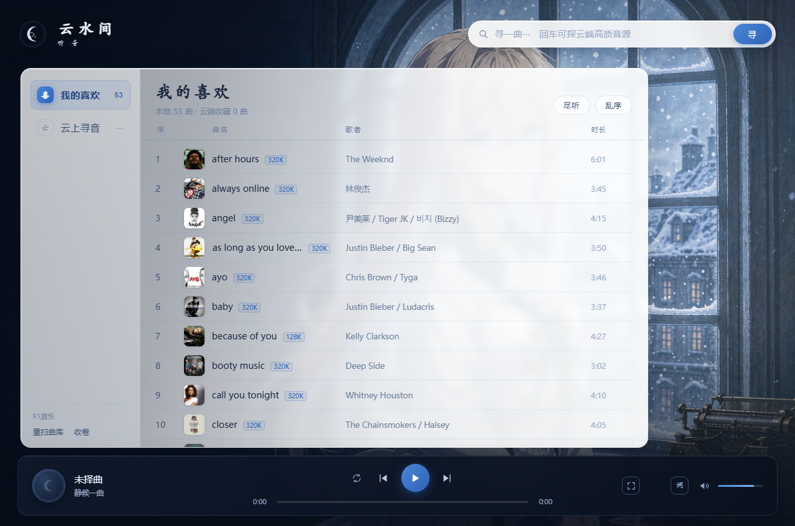

# 云水间 · 听音

> 一个本地曲库 + 云端音源双模式的桌面音乐播放器。零第三方依赖的 Python 后端，毛玻璃界面，独立窗口运行。



<sub>截图为个人使用效果，其中的背景壁纸为 AI 生成示意，仓库不含该图（见 .gitignore）。clone 后默认是深蓝渐变背景，可自行放一张 `static/wallpaper.png`。</sub>

---

## 这是什么

一个跑在本机的音乐播放器：扫描你电脑里的音乐文件夹收进「我的喜欢」，同时能搜云端曲库直接收听。**没有账号、没有服务器、不需要安装任何 pip 包**——后端只用了 Python 标准库。

窗口是用系统 Edge 的「应用窗口」模式开的，独立窗口、无地址栏，和浏览器标签页无关。

## 特性

- **本地曲库**：递归扫描指定目录，读取 ID3/FLAC 内嵌元数据，按帧扫描计算精确时长
- **云端音源**：搜索任意曲名，优先取无损 FLAC，拿不到自动降级 320K / 192K
- **云端收藏**：搜索结果一键红心，收藏进「我的喜欢」，与本地曲目混排
- **音质标识**：播放条实时显示实际码率（如 `FLAC · 2832kbps`）
- **词卷**：云端曲直接取词；本地曲按标题匹配找词，宁可显示"此曲无词"也不给错词，逐行滚动高亮
- **全屏词页**：点封面进入，大唱片旋转 + 大字歌词，`Esc` 退出
- **三种播放模式**：列表循环 / 单曲循环 / 随机，图标随状态切换
- **封面缓存**：下载过的封面存本地，二次打开毫秒级
- **沉浸模式**：双击左侧「我的喜欢」，收起全部界面，只剩壁纸和播放条
- **便携**：用户数据存 `%APPDATA%`，程序放哪都能跑

## 快速开始

需要 **Python 3.9+**（Windows）和 **Edge 浏览器**（Win10/11 自带）。

```bash
git clone https://github.com/keywhys/yunshuijian.git
cd yunshuijian
python launch.py
```

首次启动会自动找音乐目录（`~/Music`、`D:\音乐`、`F:\音乐` 等），找不到也没关系——界面左下角点路径可以随时改。

也可以用 `云水间·听音.bat` 双击启动，或用 PyInstaller 自行打包成 exe。

## 音乐目录

三种指定方式，优先级从高到低：

1. 环境变量 `YSJ_MUSIC_DIR`
2. 界面左下角点击路径 → 输入新目录 → 自动重扫
3. 自动探测（常见目录里第一个含音频文件的）

配置保存在 `%APPDATA%\云水间听音\config.json`。

## 快捷键

| 键 | 作用 |
|---|---|
| `空格` | 播放 / 暂停 |
| `←` `→` | 快退 / 快进 5 秒 |
| `↑` `↓` | 音量 |
| `N` / `P` | 下一曲 / 上一曲 |
| `L` | 展开 / 收起词卷 |
| `Esc` | 关闭词页 / 退出沉浸 |

## 技术实现

```
app.py      本地 HTTP 服务：扫库、流式播放、音源代理、歌词、收藏
launch.py   客户端外壳：起服务 + 开应用窗口 + 单实例 + 生命周期
static/     前端：index.html / style.css / app.js（无框架、无构建）
```

几个值得一提的点：

- **零依赖**：`http.server` 手写 Range 请求、流式转发、代理防防盗链
- **音频流**：支持 HTTP Range，进度条可拖动、可断点续传；上游把 FLAC 标成 `audio/mpeg` 时按文件头重新判定类型
- **连接超时**：每个连接 45 秒写超时，避免客户端切歌后线程泄漏拖死整个服务
- **时长推算**：云端搜索接口不返回时长，用文件大小 ÷ 码率反推，8 线程并发 + 内存缓存
- **封面缓存**：`pic_id` 查直链 → 下载 → 存 `covers/{id}_{size}.jpg`，同 id 加锁去重

## 已知限制

- **音源来自第三方公开聚合接口**（`music-api.gdstudio.xyz`），非官方 API。接口失效时云端功能不可用，需要更换 `app.py` 里的 `API_BASE`。
- 本地曲目找词依赖标题匹配，冷门曲目可能无词。
- 壁纸不入库（见 `.gitignore`），clone 后是深蓝渐变背景，可自行放一张 `static/wallpaper.png`。

## 免责声明

本项目仅供**学习与技术研究**使用。代码本身不含任何音频内容，所有音频与封面均来自第三方公开接口，版权归各自权利人所有。请勿用于商业用途，下载的内容请在 24 小时内删除。因使用本项目产生的任何法律风险由使用者自行承担。

## License

[MIT](LICENSE)
